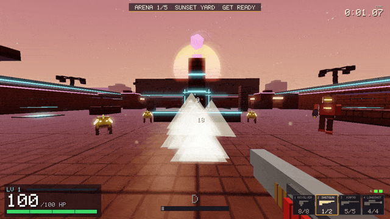

# OVERDRIVE

[](https://github.com/Ollie1o1/3d_shooter/actions/workflows/ci.yml)

**[▶ Play it in your browser](https://oliver-raczka.vercel.app/work/overdrive/#play)**, no install needed.



A fast 3D arena shooter in the spirit of ULTRAKILL, written from scratch in C++17 with **SDL2**, **OpenGL 3.3** and **GLM**: no engine. Grapple, dash, slide and slam through waves of enemies built from animated boxes, parry their shots back at them, and take on six bosses, each with its own trick to learn.

- **No engine, no asset pipeline**: textures, the sky, the soundtrack and every enemy voice are generated in code at load time
- **Desktop and browser**: runs on macOS, Windows (MSYS2) and in the browser (the same C++ compiled to WebAssembly + WebGL2); it also builds and passes its tests on Linux, though it hasn't been play-tested on a Linux desktop
- **Tested headlessly**: `make test` runs the physics, the AI, every level's data and simulated full runs, plus a boss simulator that fights the bosses' real AI with scripted players (CI on Linux, macOS and the web build)
- Fixed 60 Hz simulation, interpolated rendering (smooth at 144-360 Hz), instanced box rendering, bloom and an optional CRT filter

## Modes

| Mode | What it is |
|------|------------|
| **ARENA** | Act I. Four themed arenas of three waves each (the **Sunset Yard**, **the Foundry**, **the Spire**, **the Core** and its boss **the Warden**), then **the Sanctum**, a duel under an eclipse with **the Sovereign**. Scored and ranked on the leaderboard. |
| **ACT II** | Unlocked by killing the Sovereign. Down beneath the eclipse: **the Drowned Nave** (rising water), **the Orrery** (a sun whose flare sweeps the arena), **the Descent** (a cage riding down a shaft to **the Penitent**), **the Reliquary** (pieces of Act I drifting over a void) and **the Maw** (**the Leviathan**). Then the encore, **!!!!!**: **the Absolute**, who comes back as **MORNINGSTAR**. Keeps local best times; not ranked yet. |
| **FAST** | **The Gauntlet**: a time trial through seven rooms joined by boost tubes, with splits against your best run, par ranks and a ghost of your best route. |
| **ENDLESS** | Generated waves in the Core until you die, tougher every wave, with an objective every 4th wave and the Warden every 10th. |
| **BOSS** | Any boss on its own, with a level and upgrades to match. Your best kill time for each is kept. |

Kills earn **XP** (more for stylish play) that buys **weapon upgrades** in the Armory. Every ranked run is **scored** (style, minus damage taken, plus a time or wave bonus, times the difficulty) and good runs go on a **leaderboard** shared by every player on the website.

## The bosses

| Boss | Where | The trick |
|------|-------|-----------|
| **The Warden** | the Core (Act I) | Cut the four conduits feeding it; hit its core when it vents; survive its meltdown |
| **The Sovereign** | the Sanctum (Act I) | A sword duellist: parry (F) his sweeps and cleave as they land to break his guard |
| **The Penitent** | the Descent (Act II) | Chained to the pit wall: break the chains, jump its low sweeps, slide under the high ones |
| **The Leviathan** | the Maw (Act II) | Dash out of its crash, then shoot its eye while it lies beached |
| **The Absolute** | !!!!! (the encore) | A boxer of white light. **White** strikes: parry. **Gold**: dodge or block. **Red**: get out. Each also has a sound cue, so you can fight him by ear. Key 5 draws the sword Oathbreaker here |
| **MORNINGSTAR** | inside the eclipse | The Absolute's second form: bigger, faster, and only his white strikes show on his body |

Full details on every enemy and boss are under [Features in depth](#features-in-depth).

## Build and run

### Requirements

#### macOS

```sh
brew install sdl2 sdl2_mixer glm llvm
```

> The Makefile prefers Homebrew LLVM (some Command Line Tools installs ship a `clang++` that can't find the C++ stdlib headers) and falls back to Apple clang if LLVM isn't installed. The macOS SDK path is detected with `xcrun`, so nothing needs editing.

#### Linux (Debian/Ubuntu)

```sh
sudo apt install g++ make libsdl2-dev libsdl2-mixer-dev libglew-dev libglm-dev
make && make test
```

#### Windows (MSYS2)

1. Install [MSYS2](https://www.msys2.org/) if you haven't already.
2. Open the **MSYS2 UCRT64** shell and run:

```sh
pacman -S mingw-w64-ucrt-x86_64-gcc \
          mingw-w64-ucrt-x86_64-SDL2 \
          mingw-w64-ucrt-x86_64-SDL2_mixer \
          mingw-w64-ucrt-x86_64-glm \
          mingw-w64-ucrt-x86_64-glew \
          make
```

---

### Build (macOS and Linux)

```sh
make        # compile → ./shooter
make run    # compile + run
make test   # headless tests: physics, level data, AI, a simulated full run
make clean  # delete binaries

./shooter --play                 # skip the main menu and start an ARENA run
./shooter --fast                 # skip the main menu and start the FAST time trial
./shooter --endless              # an ENDLESS run
./shooter --boss 3               # BOSS mode: one boss on its own (1 the Warden ... 6 MORNINGSTAR)
./shooter --act2                 # an ACT II run (ignores the unlock)
./shooter --arena 4 --wave 3     # jump straight to an arena / wave (here: the Warden)
./shooter --arena 5              # the Sanctum: the Sovereign
./shooter --dev                  # open the DEV level select (also ` or F2 on the main menu)
./shooter --fast --arena 3       # jump to a FAST room (here: the Ascent)
./shooter --god                  # take no damage (for recording footage)
```

### Build (Windows)

Open the **MSYS2 UCRT64** shell (`C:\msys64\ucrt64.exe`), navigate to the project folder, then:

```sh
make              # compile → shooter.exe
make run          # compile + run
make clean        # delete binary
```

> **Important:** use the MSYS2 UCRT64 shell, not PowerShell or cmd. The Makefile auto-detects the platform.

> **Runtime DLLs:** The game links against DLLs in `C:\msys64\ucrt64\bin` (`SDL2.dll`, `glew32.dll`, `libstdc++-6.dll`, etc.). `make run` works automatically because the UCRT64 shell already has that directory on `PATH`. If you want to run `shooter.exe` outside the shell (e.g. by double-clicking), either add `C:\msys64\ucrt64\bin` to your system `PATH`, or copy those DLLs next to `shooter.exe`.

### Browser (WebAssembly)

The same C++ compiles to WebAssembly with [Emscripten](https://emscripten.org), rendering through WebGL2:

```sh
source ~/emsdk/emsdk_env.sh     # once per shell
make web                        # → web/dist/ (≈3.2 MB: wasm + preloaded shaders/sounds; ≈1.7 MB served compressed)
python3 -m http.server -d web/dist 8000   # open http://localhost:8000 (?play skips the menu, ?fast starts the time trial; ?arena=4&wave=3 jumps to the Warden, ?arena=5 to the Sovereign, ?dev opens the level select)
```

What the port needed (all behind `#ifdef __EMSCRIPTEN__`, so the desktop build is unchanged):

- `gl.h` includes GLES3; `ShaderProgram` rewrites `#version 330 core` to `#version 300 es` plus default precision at load time, so one set of shaders serves both builds (keep them free of implicit int→float conversions and uniform initializers, which GLSL ES rejects).
- `main.cpp` runs one `App::frame()` per `requestAnimationFrame` instead of a blocking loop.
- Browsers use Escape to release the mouse, so losing pointer lock pauses the game; **P** also pauses. In fullscreen, Chrome and Edge hand Escape to the game (Keyboard Lock), so pausing or closing the armory doesn't drop you out of fullscreen; hold Escape, or use **FULLSCREEN / EXIT FULLSCREEN** in the pause menu, which works in every browser (the portfolio page, which shows the game in an iframe, does the actual fullscreen through `postMessage`).
- The canvas is sized to the screen pixels it covers (CSS size × `devicePixelRatio`), capped at the graphics quality's resolution; SDL's web port reports a fixed window size, so `main.cpp` asks for the canvas size directly.
- The shared leaderboard: `web/index.html` fetches the portfolio site's `/api/overdrive-board` into `localStorage`, where the game reads it like its own board, and posts finished runs to it. With no API (a local server) the game shows its own board.
- Settings and best times are saved to `localStorage` (the Emscripten filesystem is in-memory and forgotten on reload), through `Persist.h`.
- The shell requests pointer lock with `unadjustedMovement` (raw mouse input) where supported; together with `MouseFilter.h` this stops the occasional huge bogus mouse delta Chrome reports, which used to snap the view round 180°.

## Controls

| Input | Action |
|-------|--------|
| W A S D | Move |
| Mouse | Look |
| Space | Jump / Double jump |
| Left Shift | Dash (directional) |
| Left Mouse | Fire weapon |
| Right Mouse | Aim down sights / scope (Lancer / Longshot) |
| Q | Grapple hook (rebind in Settings: Q, E, Mouse 4, Mouse 5 or Middle Mouse) |
| 1 2 3 4 / Scroll | Revolver, Shotgun, Lancer, Longshot |
| 5 | Oathbreaker, the sword (the Zenith only): Left Mouse strokes (hold, release: a thrust), Right Mouse parries then blocks, a slam with it out plunges |
| Tab | Armory: spend upgrade points (pauses the game) |
| G | Throw grenade |
| R | Reload / Retry the arena (on death) |
| F | Punch: parries projectiles, breaks a Juggernaut's smash, detonates your grenade, hits what's in front |
| Left Ctrl / C | Crouch / Ground slam |
| Enter | New run (on death/win) |
| Escape / P | Pause / Resume (Escape quits to menu from death/win screens; in a browser, Escape releases the mouse and pauses). The pause menu also toggles fullscreen |
| V | Inspect your weapon |
| Backspace | Restart the current arena / room |

**Gamepad** (Xbox layout; PlayStation and others map onto it, in browsers too):

| Input | Action |
|-------|--------|
| Left stick / right stick | Move / look |
| RT / LT | Fire / aim |
| A | Jump |
| B | Slide / ground slam |
| RB | Dash |
| LB | Grapple |
| Y | Punch / parry |
| X | Reload |
| D-pad left / right | Previous / next weapon |
| D-pad up / down | Grenade / inspect |
| Start / Back | Pause / Armory |

In menus the D-pad moves, **A** confirms and **B** goes back; on the main menu **Back** opens the dev level select.

## Code layout

The game compiles as **one translation unit**: `src/main.cpp` includes everything else, and all the code is in headers, grouped by area. The Makefile finds headers by itself (`find src -name '*.h'`), so a new file only needs an `#include`. Includes are written from `src/` (`#include "enemies/Enemy.h"`).

```
src/
├── main.cpp            entry point: SDL/OpenGL setup, command-line flags, the App::frame() loop (desktop + web)
├── core/               the platform layer: gl.h, Camera, Mesh, ShaderProgram, Display (render canvas),
│                       Collision (AABB, Wall, SpatialGrid), Settings, Persist (files / localStorage),
│                       Gamepad, MouseFilter, Difficulty, GameState (the mode / state base)
├── game/               the live game
│   ├── GameplayState.h     the game's state and an index of everything it does (declarations)
│   ├── Gameplay_*.h        its member functions by topic: Flow (the run), Tick (the 60 Hz step),
│   │                       Combat, Menus (input, pause, armory), Render, HUD, Dev, Shifts, Reliquary, Sword
│   ├── WaveDirector.h      the arena → wave → arena state machine
│   ├── DevFlags.h          the command line's globals (--arena, --god, --cam, --overlay ...)
│   └── Progression.h ...   XP and upgrades, records, leaderboards, the BOSS table; Score, Ghost, EndlessWaves
├── player/             Player (the movement controller), GrappleHook, Projectile, Weapons, Sword, StyleSystem
├── enemies/            Enemy.h (the shared state, physics and every regular enemy's AI),
│                       EnemyTypes.h (the roster, attacks, base stats), the Reliquary's Revenant and Weaver
├── bosses/             one folder per boss, each built the same way:
│   ├── sovereign/          <Boss>State.h      its state, constants and events (inherited by Enemy / EnemyEvents)
│   ├── warden/             Enemy<Boss>.h      its mind (Enemy::think<Boss>): decides, emits events
│   ├── penitent/           <Boss>Hazards.h    what it leaves in the arena (no OpenGL, unit-tested)
│   ├── leviathan/          Gameplay_<Boss>.h  its fight in the game: events → damage, effects, sound, drawing
│   └── absolute/           ...plus the Absolute's rig (AbsoluteRig.h), the feel of each move (AbsoluteFeel.h)
│                           and MORNINGSTAR (Gameplay_Morning.h)
├── world/              the maps: Level.h (Act I), LevelAct2.h, LevelGauntlet.h (FAST), ArenaShifts, Shapes, Interactable
├── render/             BoxRenderer (one instanced draw), PostProcess (bloom, CRT), TextureGen, WorldMesh,
│                       Effects, EnemyModel (every enemy's box rig), GunKit / GunMotion / ViewModel (the guns)
├── audio/              AudioSystem, SfxMixer (positional mixing), MixTable, MusicSynth (the live soundtrack),
│                       VoiceSynth / VoiceTable / EnemyVoice (the enemies' voices, built in code)
├── ui/                 MenuState (main menu), SettingsMenu, UIRenderer (HUD and overlays), UIBatch, PixelFont,
│                       LeaderboardView
└── shaders/            GLSL 3.30 (rewritten to GLSL ES 3.00 for the web at load time)
tests/                  test_physics.cpp, test_game.cpp, test_zenith.cpp, BossSim.h (see Testing)
tools/                  sound generators (gen_sfx.py, gen_arsenal.py, sfx_absolute.py, import_sfx.py),
                        record_showcase.sh (re-records docs/overdrive.gif)
web/index.html          the browser shell for `make web`
docs/superpowers/       the design specs and plans each feature was built from
```

**Rule of thumb:** nothing in `enemies/`, `world/`, or a boss's `State`, `Enemy` and `Hazards` files touches OpenGL or SDL, and `player/Player.h` only reads SDL key codes. That's what lets the tests run the real game logic without a window. (`GrappleHook.h` draws its own rope, so it's the exception in `player/`.)

### How an enemy reports what it did

Enemies never touch the renderer or the sound engine. Each tick, `Enemy::update` clears `ev` (an `EnemyEvents`) and the enemy's AI fills in what happened: shots fired, a melee hit, a slam, a boss's crash marked on the floor. `GameplayState` reads those events and turns them into projectiles, damage, particles and sound. Each boss adds its own event fields (`LeviathanEvents`, `AbsoluteEvents` …) in its `<Boss>State.h`.

## How the engine works

### Game loop (fixed timestep)

Physics runs at exactly **60 Hz** regardless of display framerate. Elapsed time is accumulated and drained in fixed 1/60 s steps. Leftover time becomes an interpolation factor for rendering, so motion looks smooth at any framerate.

```
accumulator += elapsed_time          # GameplayState::update (game/Gameplay_Flow.h)
while accumulator >= PHYSICS_DT:
    physics.update(PHYSICS_DT)
    accumulator -= PHYSICS_DT
alpha = accumulator / PHYSICS_DT   # 0..1, used to lerp camera
```

### Movement (Quake-style)

Instead of `velocity = direction * speed`, acceleration is applied incrementally each tick:

```
currentSpeed = dot(velocity_horizontal, wishDir)
addSpeed     = clamp(maxSpeed - currentSpeed, 0, accel * dt)
velocity    += wishDir * addSpeed
```

Momentum is preserved in the air, so strafe-jumping can gain a small speed boost — the same mechanic behind Quake/Titanfall/ULTRAKILL movement feel.

### Rendering pipeline

Each frame:
1. Render the procedural sky, then the static level (one draw per texture: floors/tops, sides, undersides, neon)
2. Gather everything built from boxes — enemies, debris, projectiles, doors, jump pads, pickups, the reactor — into one instanced draw
3. Bloom pass — extract bright regions → gaussian blur → composite with ACES tone mapping
4. Optional CRT pass — barrel distortion, chromatic aberration, scanlines
5. Render HUD (objective line, boss bar, waypoints, title cards) and screens on top

World geometry is batched into as few draw calls as possible. Everything dynamic is a unit cube instance, so a wave of enemies plus their debris is still one `glDrawElementsInstanced` call.

### Collision

The player is an AABB. Each wall/platform is also an AABB. Overlaps are pushed out along one axis, and a spatial grid accelerates queries so only nearby walls are tested. The axis isn't simply the one of least penetration: the player remembers where it started the tick (`Player::tickFrom`), and if it was clear of a box along an axis and now overlaps it, it came in from that side and is pushed back out there. Least penetration alone pushed fast moves (a 40 m/s slam, a long drop, a full-speed grapple) out the far side of slabs and thin walls; `make test` drops the player onto thin slabs at up to 70 m/s to keep that fixed. Overlaps it was already in at the start of the tick fall back to least penetration. Perimeter walls are low enough to stand on; what keeps you in the fight is a zone check that only allows the current arena (plus the corridor and next arena once it's cleared), with the zone's `max.y` as an invisible ceiling and an optional void plane below.

Moving platforms are ordinary walls flagged `dynamic`: `LevelData::updateMovers()` moves them every physics tick and records how far each went. They're left out of the spatial grid and tested every tick instead, the player remembers which wall it's standing on, and `GameplayState` adds that platform's movement to the player before the physics step, which is all "riding a platform" needs.

### Tuning movement feel

All knobs are public members of `Player` in `src/player/Player.h`:

| Variable | Default | Effect |
|----------|---------|--------|
| `horizontalSpeed` | 7.0 | Max ground speed (m/s) |
| `gravity` | -24.0 | Fall acceleration |
| `jumpForce` | 8.5 | Jump height |
| `acceleration` | 80.0 | Ground responsiveness |
| `airAcceleration` | 42.0 | Mid-air steering |
| `friction` | 10.0 | Ground deceleration |

## Testing

```sh
make test
```

Three headless test programs, no window or GPU needed (CI runs them on Linux and macOS, and builds the web version):

- **`tests/test_physics.cpp`**: the player controller. Landing, ledges, ceilings, slides, and fast landings on thin floors at up to 70 m/s (the case that used to push you through slabs).
- **`tests/test_game.cpp`**: every level's data (no spawn inside a wall, every jump pad lands, every moving platform stays clear of walls), the enemy AI, rigs, weapons, XP, the mix table, and simulated full ARENA, FAST and ACT II runs.
- **`tests/test_zenith.cpp`**: the encore. The sword, the Zenith, and **BossSim** (`tests/BossSim.h`), which pits the real AI of the Warden, the Sovereign, the Leviathan and the Absolute (both forms) against scripted players: cheese strategies that must fail, a solid player whose kill time must land in a target range, and a dodger. BossSim is deterministic, so a change that shifts its numbers changed the fight.

## Dev tools

Everything below runs without touching the mouse, so it works from scripts.

```sh
# Render N frames, save the last as a BMP and quit
./shooter --arena 3 --cam 0 3 -129 -90 18 --weapon 4 --aim --shot 90 shot.bmp
#   --cam X Y Z YAW PITCH   --weapon 1-4   --aim   --res LINES
#   --overlay armory | pause | settings | victory | poseN (hold the Sovereign in pose N: 0-9)
#                reloadNN | inspectNN | switchNN | punch (hold the gun NN% through it)
#                penitentN (hold the Penitent: 0 kneeling, 1 low sweep, 2 high sweep, 3 risen, 4 scourging)
#                leviathan2 | leviathan3 (start the Leviathan in its hunt / its eclipse)
#                absolute2 | absolute3 | absolute8 (the Absolute's ascension / his blade / the last judgment)
#                abposeN (hold the Absolute mid-tell: 1 jab ... 10 judgment, 11 reeling, 12 broken, 13-20 cross, backfist,
#                elbow, roundhouse, haymaker, shoulder charge, axe kick, clap, 21 skyfall, 22 meteor, 23 aloft; 0 his guard)
#                ascend (the act's card, then the rise into the Zenith)
#                morning | morning5 | morning6 (start MORNINGSTAR / in RISING / in TOTALITY), swallowNN (the swallow, NN% through)
#   --act2 --arena 3 --wave 4: straight to the Penitent (the cage is simply there with --cam)
#   --act2 --arena 5: straight into the Maw and the Leviathan
#   --act2 --arena 6: straight into !!!!! (the Zenith) and the Absolute (add --cam ... so the armory doesn't open)
#   --sword: the sword on key 5 in any arena; --weapon 5: start with it drawn
#   --spawn TYPE (repeatable): enemies in an arc in front of the camera
#     0 Husk  1 Ripper  2 Sentinel  3 Raptor  4 Brute  5 Mite  6 Juggernaut  7 Warden  8 Sovereign  9 Shieldbearer
#     10 Conduit  11 Conductor  12 Seraph  13 Anchor  14 Penitent  15 Revenant  16 Weaver  17 Leviathan  18 Absolute
#   --hollow N: --spawn enemies are Hollowed (1 Enraged, 2 Twinned, 3 Haloed)

# Footage: fixed 1/30 s frames; skip SKIP, then save FRAMES as PREFIX_0001.bmp ...
./shooter --arena 5 --god --cam 0 1.8 -310 -90 2 --spawn 8 --autoaim --kite --clean --record 180 30 out/boss
#   --campath X Y Z YAW PITCH  glide the camera there over the recording
#   --autoaim  turn onto the nearest enemy in sight and fire      --kite  back off from whatever gets close
#   --clean    no title cards or enemy cards
tools/record_showcase.sh         # re-record docs/overdrive.gif (needs gifski)

# Frame times
./shooter --bench 2000 --arena 4 --wave 2 --god [--cap HZ] [--res LINES]
#   prints a per-zone breakdown (events, sim parts, render passes, present, swap) and the worst frames
#   --frametimes FILE  per-zone CSV of every frame, written on exit (works in normal play too)
#   --gpu-timer        add GPU time via GL timer queries; on macOS reading them stalls the CPU, so
#                      frame times run ~2x slower while it's on. ACT II needs --cam or it times the armory
#   --skip sky,world,boxes,water,fx,viewmodel,bloom,hud   leave render passes out to see what each costs
#   (--fast means FAST mode, not "start quickly": use --play for ARENA)

# Record the final mix (music + effects) to a WAV, then quit
./shooter --arena 5 --god --kite --audiodump mix.wav 15
OVERDRIVE_SFXLIST=1 ./shooter ...   # print every loaded sound and its length
./shooter --mixreport              # every sound's level against its mix target, then quit
```

**In the game:** `` ` `` or **F2** on the main menu opens the **DEV level select** (also `--dev`, or `?dev` on the web build): any arena and wave (Act I or Act II), any FAST room, with god mode on or off. These are practice runs (no records, no leaderboard); in one, **F5** clears the current wave and **F6** refills health.

## How to extend

### Add a wall / platform

In `world/Level.h`, inside the arena's block in `buildLevel()`:

```cpp
wall(x0, y0, z0, x1, y1, z1, color);   // solid, rendered
prop(x0, y0, z0, x1, y1, z1, color);   // rendered only
neon(x0, y0, z0, x1, y1, z1, color);   // self-lit trim
```

`make test` then checks that no spawn point ended up inside it, that every jump pad still lands on its platform, and that no tall scenery sits inside an arena.

### Add a moving platform

In `world/Level.h` (or `LevelGauntlet.h`, `LevelAct2.h`): `B.mover(centre, halfSize, Mover::Path::PINGPONG, offsetA, offsetB, period, phase, glowColour)`, or `Path::ORBIT` with two radius vectors. `make test` sweeps every mover through two full periods and fails if it ever passes through a wall.

### Add a weapon

1. Add an id to `WeaponId` and a row to the table in `player/Weapons.h` (damage, pellets, spread, fire rate, magazine, reload, aim zoom, pierce, recoil, mod).
2. Give it a recipe in `render/GunKit.h` (like `buildRevolver`) and its motion in `render/GunMotion.h`.
3. Add its sound name to `SND[]` in `GameplayState::fireWeapon()` (`game/Gameplay_Combat.h`).
4. Give it an icon in `UIRenderer::drawWeaponIcon()`. The slots, Armory, ammo and reload all follow from the table.

### Add an enemy type

1. Add a value to `EnemyType` and a row to the stats table in `enemies/EnemyTypes.h` (health, size, speed, colours, tip text).
2. Write its `think…()` in `enemies/Enemy.h`; report attacks through `ev` (shots, melee, slam…).
3. Build its rig in `buildEnemy()` in `render/EnemyModel.h`.
4. Add it to a wave in `world/Level.h`.

### Add a boss

Make a folder under `bosses/` with the four files every boss has: `<Boss>State.h` (add its `State` and `Events` structs to the base lists of `Enemy` and `EnemyEvents` in `enemies/Enemy.h`), `Enemy<Boss>.h` (its `think…()`, included at the end of `Enemy.h`), `<Boss>Hazards.h`, and `Gameplay_<Boss>.h` (included at the end of `game/GameplayState.h`). Add it to `isBoss()`, give it a BOSS mode row in `game/Progression.h`, and a BossSim case if its fight should be held to a kill time.

## Features in depth

<details>
<summary><b>ACT II, arena by arena</b></summary>

unlocked by killing the Sovereign. Fall beneath the eclipse into **the Drowned Nave**, a flooded cathedral: the water slows you on foot but slides skim across it, and it rises every wave until only the galleries, bridges and the organ loft stay dry. Then down a shaft into **the Orrery**: a terrace round a void where two rings turn over a captive sun. The sun's flare sweeps the arena (get behind a pillar), and in wave 2 you hold a circle that rides the inner ring. Then through the north arch into **the Descent**: a cage that rides down a vast shaft, stopping at a different floor for each wave (bell galleries, the brake clamps you shoot to release it, a furnace ring), and at the bottom, **the Penitent**: a kneeling colossus chained to the pit's walls. Break its six chains (shoot the anchors, or grapple onto one and hang on to rip it out), jump its low censer sweeps and slide under the high ones; unchained it rises and stalks you, and near death it scourges itself, opening a wound on its back. Its death opens the pit's south wall onto **the Reliquary**: pieces of the four Act I arenas (the Yard, the Foundry, the Spire, the Core) drifting over a void, regrouping between waves (scattered, a ring, a stack, then a path to a dark hole), fought on with jumps, dashes and the grapple; fall and you're back on the last relic you stood on. Its two new enemies: **the Revenant**, whose soul flees to another relic when it dies (catch it or it comes back), and **the Weaver**, which strings snaring wires across your way. Clear it and the hole opens: jump in, and fall into **the Maw**, a cavern of cracked stone round a black pool, where **the Leviathan** rises: a colossal plated serpent with an eclipse for an eye. It crashes its head down along a strip it burns into the floor (dash out, then shoot its eye while it lies beached, or stand your ground and punch it as it lands), spits orbs you can parry back into its eye, and rolls tides over the ring to jump. Under 65 % it hunts from beneath the floor and breaches out of the well nearest you; under 30 % the Maw floods, its eye stays open, and it tries to swallow you whole (run, or shoot down its throat until it chokes). Its death ends the act (the clear is saved there and then), and the eclipse breaks: you rise into **!!!!!**, the encore, a floating ruin at sunset (the eclipse low on the horizon, the sun's corona burning round it), to face **the Absolute**: a figure of white light with red eyes and rune-lit gauntlets, a boxer faster than you, who fights in combos and takes to the air. Every strike flashes a colour: **white**, parry it (F, or the sword); **gold**, dodge or block it; **red**, get out of where it lands. And every one can be fought by ear: a wind-up that rises into the blow, then a cue on the beat to act on (a bright **ting**: parry; a low **doom**: dodge or block; a double **pulse**: get out), then a boom whether it lands or not. Here, and only here, key 5 draws **Oathbreaker**, a sword: three-stroke combos and a charged thrust that heal you as they land, right click to parry (the first 0.15 s) or block (a guard meter that breaks). ACT II runs are not ranked yet; the act and the Zenith keep local best times.

</details>

<details>
<summary><b>FAST: the Gauntlet, room by room</b></summary>

seven rooms, each reached down a ribbed **boost tube** (a breather: health waiting, nothing shooting at you) that fires you along at 26 m/s. Step into the room and the fight starts: the door behind you locks, and the exit unlocks when the room is clear. A waypoint points to the exit.
  1. **The Canal** (north): a sunken lane between raised walkways, bridges across it
  2. **The Sluice**: close quarters
  3. **The Ascent** (turn left, climb): five terraces up 20 m, each riser with a pad and a step block; gunners hold the high ground
  4. **The Span** (north, 23 m up): islands, a beam, ferries and grapple anchors over a void (fall and you're back at the landing)
  5. **The Well** (turn right, drop): a tower you fall through, floor by floor, gunners on each
  6. **The Pumpworks** (east): a roofed tunnel with a lava strip opening into a hall with galleries
  7. **The Tower**: win the courtyard (two waves), then ride the lifts or grapple to the beacon on top

  A 3-2-1 countdown starts the clock; every room clear shows a split (green ahead / red behind your best run); the clock stops at the beacon. Ranked S/A/B/C/D against par times. Dying (or Backspace) restarts the room with the clock still running. A glowing **ghost** runs the route of your best time alongside you (FAST GHOST in Settings turns it off).

</details>

<details>
<summary><b>Combat and the arsenal</b></summary>

- **One arsenal**: all four guns share one body (blackened gunmetal, worn steel, bone grips) and each glows its own colour (revolver amber, shotgun ember, Lancer cyan, Longshot violet) in its accent strips, muzzle flash, tracers, shell casings, hit sparks and HUD slot. **Ammo cells** on every gun light for the rounds left (upgrades add cells), go dark as you fire and relight one by one as you reload. They all move by the same rules (`GunMotion.h`): a kick that settles by the gun's weight, a switch where the old gun drops and the new one rises as its cells boot up with a chime, and reloads in three beats (open, feed, close) with every sound on its beat. The gunshots are one family too (`tools/gen_arsenal.py`): the crack of a real recording, a synthesized thump, a metallic ring in the gun's pitch and a tail, three variants each
- **Revolver** (slot 1) — 8-round hitscan with auto-reload
- **Shotgun** (slot 2) — 2-shell pump-action, 10 pellets per shot with spread
- **Lancer** (slot 3) — a long, slim bolt rifle in blackened steel, its cells glowing cyan along the receiver. RMB raises the iron sights (a small zoom; the front post sits in the rear notch on screen centre). 120 damage, 3x on the head: a headshot one-shots anything but the boss. Accurate aimed, loose from the hip or in the air
- **Longshot** (slot 4) — heavy .50 sniper. RMB brings up a full scope (mil-dot reticle, heavy zoom). 300 damage one-shots every regular enemy and punches through three of them (**COLLATERAL**). Fire as the scope settles for a **QUICKSCOPE** bonus; kill without aiming for a **NOSCOPE** bonus
- **Oathbreaker** (slot 5, the Zenith only) — a sword in the arsenal's gunmetal, bone and brass, its fuller of eight rose-red cells showing the guard meter. LMB: a three-stroke combo (70/70/120) with a lock-on step; hold 0.5 s and release for a thrust 8 m forward (220); slam with it out to plunge (150). RMB: the first 0.15 s parries a white strike, a projectile or a ray just fired (the next stroke is a riposte, x2.5); held, it blocks hits from the front (25 % taken) until the guard meter breaks. Every hit heals 6, every parry 10
- Aiming scales mouse sensitivity with the zoom (plus a ZOOM SENSITIVITY setting) and slows you a little
- **Grenades** (G key) — parabolic arc, 5m blast radius, refill every 2 kills
- **Punch / parry** (F) — a fist you can see, once a second (no spamming it). Parries an enemy shot in front of you (the window grows with the shot's speed) and sends it where you're looking for 60; a Juggernaut's siege shell comes back for 400 and ignores armor. Punch a Juggernaut in the last moment of its smash to **break** it (staggered, double damage). Otherwise it hits whatever's in front of you. A parry lands with a metal clank, a gold flash and a hit-stop
- **Projectile Boost** (F near own grenade) — detonate for 3x damage AoE

</details>

<details>
<summary><b>XP, upgrades and drops</b></summary>

- Kills give XP by enemy type, multiplied by your style rank (D x1 up to SSS x2); trick shots give bonuses
- Each level is an upgrade point. **Armory (Tab)**: per gun, three tiers each of DAMAGE (+20%), FIRE RATE (-15% between shots) and MAGAZINE (more rounds, faster reload), plus one MOD (2 points): Piercing Rounds, Dragon Breath (+5 pellets), Headhunter (Kar headshot kills refund the round and skip the bolt), Explosive Tips
- Upgrades survive dying and retrying; a new run starts at level 1
- **Drops**: health orbs (20%, small heal, magnetic), **health potions** (18%, +40 HP, red loot beam, only picked up when you're hurt so they wait for you) and **XP shards** (10%). Brutes always drop orbs and often a potion

</details>

<details>
<summary><b>Movement</b></summary>

- Quake-style air strafing with momentum preservation
- Double jump, directional dash (2 charges), ground slam
- Grapple hook with slingshot release (a 1.5 s cooldown in arenas, none in FAST); **moving platforms** (lifts, sweepers, ferries, orbiting platforms) can be hooked with generous aim assist (cyan brackets on the crosshair) and pull you to land on top; standing on one carries you with it
- Sliding with momentum boost
- Every arena has an **invisible ceiling** (a force field that flashes when you hit it) so dashes and grapples can't launch you out over the walls

</details>

<details>
<summary><b>Every enemy and boss</b></summary>

Every enemy is a rig of boxes on joints (hips, shoulders, wing roots) posed from its AI state each frame: legs swing with the walk cycle, wings flap, and arms come up to aim or slam during a wind-up, so you can read an attack before it lands. Each type teaches a different answer:

| Enemy | Looks like | What it does | Answer |
|-------|------------|--------------|--------|
| **Husk** | Humanoid rifleman, glowing visor | Holds mid range, strafes, fires slow orbs | Parry the orbs back (F) |
| **Ripper** | Low four-legged hound with blades | Zig-zags in, crouches, lunges | Dash out of the lunge |
| **Sentinel** | Tall cyclops sniper | Paints you with a laser, then fires a fast 3-round burst | Break line of sight while the laser is up |
| **Raptor** | Bird with a 4 m flapping wingspan | Circles overhead shooting, then dives at you | Watch the sky |
| **Brute** | 2.9 m heavy with a glowing chest core | Walks you down and slams the ground; lobs at range | Jump the shockwave |
| **Mite** | Small spider bomb | Rushes in and detonates | Shoot it early: its blast hurts its friends |
| **Juggernaut** | 3.3 m armored heavy with a cannon arm | Armor halves bullet damage; fires slow siege shells, smashes up close | Parry the shell (400 back), or punch the smash to break it |
| **Shieldbearer** | Soldier behind a tower shield with a glowing sigil | The shield stops bullets from the front; advances slowly, fires spreads of orbs, bashes up close | Flank it (it turns slowly), shoot the head over the rim, use explosives, or parry the bash to knock the shield aside |
| **Conductor** | A hovering emitter with a glowing core and turning fins | Doesn't attack: tethers up to three nearby enemies (cyan beams, a ring over each head) and they take no damage at all while it lives (shots spark off them); hangs back above and behind them | Shoot it down first (90 HP); the tethers drop with it |
| **Conduit** | A pylon with a pulsing core and turning rings | Doesn't fight: the wave spawns out of it | Destroy it (300 HP); the core beats faster as it breaks |
| **Seraph** (Act II) | Winged figure with a ring for a head | Hangs high and far; charges, then sweeps a beam toward you that turns slower than you run | Keep moving, break line of sight, or hit it hard (or in the head) while it charges |
| **Anchor** (Act II) | Hunched heavy with a ring core on its back | Projects a 10 m field where you can't dash or grapple; lobs slow orbs | Fight it from outside its field, or go in and kill it first; parry the orbs back for 120 |
| **Warden** | 4.6 m crowned boss, cabled to the Core's pillars | A reactor-fed guardian in three phases. **Charging**: four conduits on the pillars feed it (it takes half), it volleys, slams and calls Mites, and every third attack it vents, its core open. **Overload** (60%): it walks to the reactor and feeds; the reactor fires rings, it sweeps a lance that a pillar stops, each lance ending in a vent; hide or keep away and a seeker finds you. **Meltdown** (25%): it tears free, its core open, everything faster, lunging at you, with 40 s on the clock before it goes off (it hurts you and heals back to a quarter) | Shoot the conduit nodes (all four cut: it reels 4 s); hit the core when it vents (x3, x2 in meltdown); parry its orbs back into the core (150); jump the rings; punch a lunge as it lands (it reels) |
| **Sovereign** | 3.5 m horned knight with a greatsword, a halo and a cape | Act I's final boss. Dashes at you and dashes again; chains two sweeps into an overhead cleave with a shockwave; leaps onto any platform you climb; throws crescent slashes at range. Enrages at half health: faster, longer chains, double crescents, and the eclipse turns to blood while the orbiting platforms speed up | Dash through the dashes, jump the cleave's shockwave, and **parry (F) a sweep or the cleave as it lands** to break his guard for 3 s (he takes double while broken). Every tell lasts at least 0.35 s (0.28 s inside a combo), every recovery 0.8 s, and he pauses a moment at each phase |
| **Revenant** (Act II) | A gaunt machine-knight, a white-blue soul glowing in its cracked chest | Rakes twice up close, throws a slow soul bolt at range. When its body dies its soul flees to another relic and re-forms it at half health (twice at most) | Shoot or punch the fleeing soul; parry its bolt |
| **Weaver** (Act II) | A long-legged spider machine with a violet spinner | Keeps its distance and strings a glowing wire at chest height across your way every few seconds (up to four); touching one snares you, hurts and wakes the wave | Slide under or jump over; shoot a node to cut it; kill it and its wires drop |
| **Leviathan** (Act II's final boss) | A colossal plated serpent rising out of the Maw's pool: an iron skull, a jaw of turbine teeth, and an eclipse for an eye (a black disc in a burning corona) | Rears and **crashes** its head down along a strip burned into the floor (red, a deep roar), then lies beached; a **torrent** of orbs (the throat glows cyan, a gurgle); a **tide** rolled over the ring by its tail (a hiss); a **spit** for anyone keeping away, hiding or perching. Under 65 % it dives and **breaches** out of the well nearest you (the well boils first); under 30 % the ring floods, its eye stays open, and it **swallows**: an inhale that drags you toward its mouth | Dash out of the strip and shoot the eye while it's beached (x3), or punch it as it lands (staggered 4 s); parry an orb back into its eye; jump the tide; get clear of a boiling well; run from a swallow, or shoot down its throat until it chokes |
| **The Absolute** (the encore, in the Zenith) | A 2.6 m figure of white light, the most detailed model in the game: plated muscle, jointed fingers, wraps trailing light, two red eyes, gauntlets with rune bands and a broken halo; a boxer's guard | Fights in **strings**: TOO SLOW (a teleport behind you, jabs, a hook), KNEEL (an uppercut that launches you into a drop-kick), FLURRY (jab-jab-jab-cross), BREAKER (jab, cross, a gold haymaker), CROSS-UP (a backfist and a roundhouse from behind), BULLRUSH (a shoulder charge, an elbow, a red clap), HEEL OF HEAVEN (an axe kick, a stomp ring), a ray; serpents of light at range. He **flies**: up 9-14 m, circling you, then SKYFALL (a gold circle under you, then he crashes onto it - and onto a shard you camp on, breaking it) or METEOR (a white dive at you: parry it and he's knocked out of the sky). Up there his guard is down: 6 % of his health in one flight shoots him down. Every strike flashes **white** (parryable), **gold** (not) or shows **red** on the floor. Under 60 % he ascends: a 360 sweep that shatters four pillars, longer, quicker strings, mirages, burning seams, a ray from the Halo for anyone on the shards. Under 25 % he draws a blade of light; at 8 % the last judgment | Parry the white (he reels; twice in one string and he breaks for 3 s), dodge or block the gold, leave the red; slide under the sweep, stand in the dark cells, stay beside him at the judgment. A **sword** parry of his blade shatters it. Past 14 m his guard turns your shots aside: get close |
| **MORNINGSTAR** (the Absolute's second form) | The Absolute at 1.65x, blood orange with white eyes | His lethal blow doesn't kill him: he kneels, the eclipse swallows the Zenith, and he comes back with a fresh health bar inside it. Three phases: MORNINGSTAR (jabs, a backhand, GRASP, his ECLIPSE drop, SUNDER rings, FISSUREs, the CORONA's flares from the ring of fire), RISING under 55 % (every slam leaves an aftershock, everything quicker) and TOTALITY under 12 % (the ring of fire collapses on you, then the light goes out of him). A death here retries from his second form | Only white shows on his body (parry it; the backhand can be parried too); his gold and red moves are read from the floor. Jump the collapsing ring |
| **Penitent** (Act II) | A kneeling machine-monk, 8 m tall, hooded, a bone mask, two censers on chains, chained to six anchors on the pit wall | The Descent's boss. Chained, it can't move and takes a quarter of the damage: censer sweeps low (amber, a grinding whine) and high (white, a bell), a slam ring, burning incense pools, and a chain lash for anyone who keeps away or perches. With every chain broken it rises to 11.5 m and stalks you, sweeping in pairs and calling up Hollowed Husks; under a quarter health it scourges itself (rings of embers, everything 30% faster) | Shoot or rip the anchors; **jump the low sweep, slide under the high**; parry a censer as it reaches you (it reels, double damage); under a quarter, get behind it and hit the glowing wound (x3) |

- Ground enemies steer around cover with feeler probes (no pathfinding; the arenas are open by design) and keep apart with soft separation
- **Hollowed variants** (Act II): an **Enraged** enemy is faster, quicker to strike and hits harder; a **Twinned** one splits into two smaller copies when it dies; a **Haloed** one takes a tenth of the damage until a headshot or a parry breaks its halo. Worth 1.5x the XP and style.
- Gunners and Brutes won't walk off a ledge; Rippers and Mites jump down after you
- Gunners check line of sight before firing and sidestep out from behind cover when blocked
- Enemies materialise in a column of light (untargetable for 0.9 s) and break apart into their blocks when killed
- Health orbs drop from kills (Brutes always drop three) and home in when you're close
- Headshots deal bonus damage (revolver 1.5x, rifles more). Every enemy with a head has a real head hitbox that follows the drawn model (walk bob, a broken Juggernaut's slump, a Ripper's crouch, a Raptor's dive); a headshot flashes the hitmarker gold

</details>

<details>
<summary><b>Arenas and waves (Act I)</b></summary>

- **Four arenas**, each with its own lighting, fog and sky: the **Sunset Yard** (four corner buildings break the square into a plaza with four arms, and their rooftops are joined into a ring of bridges at 5 m, with market stalls to duck behind), **the Foundry** (roofed, lava channels you can lure enemies into, a furnace to climb, side and cross catwalks forming a loop at 5 m, a crane platform to grapple), **the Spire** (a 26 m tower at dawn: ledges, bridges, a balcony and the summit, linked by jump pads, lifts, sweepers and orbiting platforms; each wave spawns a tier higher, and the gunners up there hold their perch, so you have to climb), and **the Core** (night sky, a reactor ringed by pillars; an outer walkway ring at 4 m linking the corner perches and an inner ring at 7 m across the pillar tops). Every arena loops: there's always somewhere to run, on the ground or above it
- Each arena has three waves; the director keeps at most 6–10 enemies on the field and trickles the rest in as you kill, spawning them away from you
- **Objectives**: some waves aren't "kill everything". **HOLD THE DAIS** (the Yard's last wave) and **HOLD THE BALCONY** (the Spire): stand in the ring until it fills; it only fills while no enemy on foot is inside it. **DESTROY THE CONDUITS** (the Foundry): the wave pours out of three pylons until you bring them all down. **SURVIVE THE OVERLOAD** (the Core): last 45 seconds. These waves keep coming until the objective is met; then whatever's left collapses (+40 XP)
- **Arenas that change as the fight goes on**: the sun sets over the **Yard** wave by wave (its last wave is fought at night); on the **Foundry**'s last wave the lava channels spread from 3 m to 9 m, cutting the floor into islands (the catwalks are the safe way round, and it's a bigger trap to lure enemies into); the **Spire**'s platforms speed up each wave (x1.3, x1.6); and during the **Core**'s overload the reactor fires a ring of energy along the floor every 4.5 s (it flares first): jump it or get up on a walkway. The rings burn enemies on foot too, and the lights go red. A retry puts it all back
- **Squads**: some enemies arrive with an escort in formation: a Shieldbearer screening a Sentinel or two Husks, a Juggernaut with Mites at its feet
- New enemy types get a title card the first time they appear, with a one-line tip on how to beat them
- Clearing an arena opens its gate and points a waypoint at it; walking into the next arena closes the gate behind you
- **Jump pads** launch you onto platforms; the lighting blends between arenas as you walk the corridor
- The last three enemies of a wave get on-screen markers so you never hunt for a straggler
- Dying offers **retry this arena** (R) or a new run (Enter); enemy damage scales up from 70% in the first arena to 110% in the last

</details>

<details>
<summary><b>The style system</b></summary>

- ULTRAKILL-inspired style meter (D → C → B → A → S → SSS)
- Style gained from kills, parries, dashes, slams, grenade multikills
- **Freshness**: scoring with the same thing over and over earns less. Each gun, the punch, parries, explosives, the slam and the environment wear out as they score (FRESH x1.5, USED x1, STALE x0.5, DULL x0.2) and recover while you use something else; the gun in hand's freshness shows beside the style bar. Movement style (dashes, grapples, jumps) isn't affected
- Kills you only set up (lava, the void, enemies hurting each other) can carry the meter into rank B but no further: the top ranks and Overdrive come from what you do yourself
- **Friendly fire**: a Juggernaut's siege shell ploughs into any enemy in its path, and a Brute's slam or a Juggernaut's smash hurts the enemies around it (bosses are immune). Bait them into a crowd: those kills count as yours (+10 XP, half the kill style)
- Overdrive mode at max style — dash charges refill on kill
- Style decays after 3 seconds of inactivity

</details>

<details>
<summary><b>Visuals</b></summary>

- **Procedural textures** — grid concrete floor, brick walls, brushed metal ceiling (no external image files)
- **Procedural sky** — gradient, sun or moon (with synthwave bands in the Sunset Yard), stars and two mountain ridges, computed per pixel from the view direction
- Distance fog and hemisphere ambient per arena; self-lit neon trim; ACES filmic tone mapping
- World-space UV mapping for consistent texture tiling
- Bloom post-processing (bright pass → gaussian blur → composite)
- **CRT filter** (optional, toggle in settings) — barrel distortion, chromatic aberration, scanlines, vignette
- PSX-style vertex snapping (configurable)
- Hitscan tracers, muzzle flash, screen shake, hit-stop on kills
- Impact decals, explosion particles, shell casings
- Damage direction indicators on screen edges
- Dithered grapple rope rendering

</details>

<details>
<summary><b>Audio</b></summary>

- **Procedural sound effects** — synthesized in Python (`tools/gen_sfx.py`): jumps, landings, slams, reloads, bolts, hits, kills, telegraphs, explosions, stingers, spawns, pickups, level-ups
- **Recorded sounds** from free CC0 (public domain) packs, cut, trimmed and layered by `tools/import_sfx.py`: the four gunshots (real pistol, shotgun and rifle recordings), the dash whoosh, the grapple, footsteps (four variations), the punch and the parry clank. Sources in [`assets/sfx/CREDITS.md`](assets/sfx/CREDITS.md)
- Every sound is trimmed to start within a few milliseconds of being triggered, so shots never feel late
- **Our own effects mixer** (`audio/SfxMixer.h`, in the same audio callback as the music): enemies, doors, blasts and boss attacks sound from where they happen (quieter and darker with distance, panned to their side, muffled behind you); every play varies a little in pitch and level, and a sound with numbered variants (`name_1.wav` …) never repeats one twice running; voice caps per group (player, enemies, world, UI) keep a crowd from turning to noise without ever cutting your gun or the boss; the music and the world duck when you're hit, a wave starts or a boss winds up; each arena has its own reverb (the open Yard, metal halls, the long dark Sanctum, Nave and Orrery)

</details>

<details>
<summary><b>Game flow, settings and saving</b></summary>

- **Victory screen** — after the Sovereign: time, kills, accuracy, deaths and the run's **score**, part by part: style earned, time bonus (10 a second under a 15-minute par), damage taken (2 a point), times the difficulty (x0.75 LENIENT to x1.5 BRUTAL). An ENDLESS run ends when you die, on a RUN OVER screen with its score (style + 500 a wave cleared)
- **Leaderboard** — make the top 10 and you're asked for a name (or ESC to skip). ARENA and ENDLESS rank by score, FAST by time. LEADERBOARD on the main menu shows those three, plus your best kill time for each boss (BOSS mode, kept on this machine). ACT II runs keep local best times but aren't ranked yet. On the website it's the **world** board, shared by every player (the site's `/api/overdrive-board`, checked server-side for plausible scores and times); elsewhere it's this machine's. Only full runs count: not one started at a later arena, in god mode or from the dev level select
- **DEV level select** (` or F2 on the main menu, `--dev`, `?dev` on the web) — jump to any arena (and wave), any FAST room, with god mode on or off. These are practice runs (no records, no leaderboard); in one, F5 clears the current wave and F6 refills health
- **Death screen** — where you died, with retry-arena and new-run options
- **Pause menu** — Escape mid-run pauses: Resume / Settings / Restart / Quit to Menu
- R retries the current arena; Enter starts a new run
- **Settings** (main menu and pause menu, keyboard or mouse, sliders drag): field of view, fullscreen (also F11 / Alt+Enter), frame rate (match display, 60–360, unlimited), VSync, **graphics quality** (LOW 720p / MEDIUM 1080p / HIGH 1440p / EXTREME 4K render resolution, plus anisotropic texture filtering above LOW; in the browser the canvas gets the screen's real pixels), show FPS, CRT filter, screen shake, view bob, mouse sensitivity, zoom sensitivity, invert Y, mouse spike filter, master and music volume, **difficulty** (LENIENT / STANDARD / VIOLENT / BRUTAL — also LEFT/RIGHT on the main menu), run timer, damage numbers, FAST ghost, crosshair colour
- **Enemy voices** — every enemy is a machine body carrying a hollow choir, built in code when the game loads (`VoiceSynth.h`, no audio files): its own spawn, idle murmur, steps or wingbeats, a wind-up tell for every attack (the Sovereign sings a different syllable for each stroke, the Penitent groans before a low sweep and rings a bell before a high one), a release, a hurt and a death. The voice director (`EnemyVoice.h`) decides who speaks: every wind-up within 40 m is heard, even out of sight; only the nearest few chatter; hurts and spawns are rationed. Hollowed enemies sound changed (Enraged higher and driven, Twinned doubled, Haloed shimmering, and their halo shatters)
- **A threat-aware mix** — every sound has a role: while a wind-up plays, enemy chatter steps back 3 dB (the music is left alone) and chatter never takes a tell's voice. Every sound's level lives in one table (`MixTable.h`, held by a test; `./shooter --mixreport` prints them all); `OVERDRIVE_SOLO=tell|chatter|action|ui` hears one role alone
- **Soundtrack** — synthesized live (`MusicSynth.h`, no audio files): darksynth/industrial, a track per area (and one for the Sovereign), layers that build from the tubes into the fight and up again for the boss, muffled while paused
- **High refresh rates** — physics stays at a fixed 60 Hz while enemies, projectiles, pickups and platforms are interpolated between ticks, so 144/240/360 Hz is smooth; the frame limiter sleeps then spins to hold a cap to within microseconds. `./shooter --bench N [--cap HZ] [--res H]` prints frame times
- Settings, best times, the leaderboard and your best FAST ghost persist across launches (`settings.cfg`, `records.v2.cfg`, `leaderboard.cfg`, `ghost.v2.cfg` next to the binary; `localStorage` in the browser)

</details>

<details>
<summary><b>HUD</b></summary>

- Health as a big number with a bar (pulses red when low), level and XP bar, four weapon slots with ammo counts and reload bars, grenade pips, style rank
- Floating damage numbers (gold on headshots), a kill/pickup feed, toasts for level-ups and trick shots, run timer and splits
- The whole HUD is batched into a few draw calls (`UIBatch.h`); it used to be one draw call per pixel of text

---

</details>

## Dependencies

| Library | Purpose | Platform |
|---------|---------|----------|
| SDL2 | Window, input, OpenGL context | all |
| SDL2_mixer | Sound effects | all |
| OpenGL 3.3 | Rendering | all |
| GLM | Math — vectors, matrices, transforms | all |
| GLEW | OpenGL function loader | Windows |
| LLVM/clang++ | Compiler (Homebrew) — replaces system clang | macOS |
